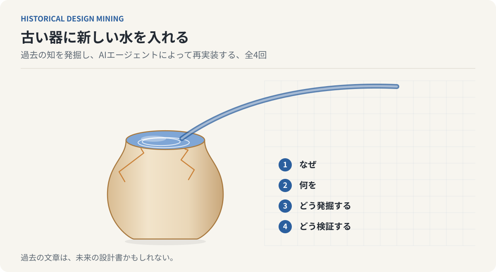

# 古い器に新しい水を入れる

**過去の知を発掘し、AIエージェントによって再実装する**

過去の論文・文章に記述された技術的構想を、単なる歴史資料ではなく、現代の技術で実装可能な設計資産として読み直す全4回の連載。



[第1回から読む](articles/01-past-texts-as-future-designs.md) ／ [全文を一つのページで読む](complete.html)

## 全4回の目次

| 回 | 文章 | 主題 |
| --- | --- | --- |
| 01 | [過去の文章は、未来の設計書である](articles/01-past-texts-as-future-designs.md) | 技術は進歩するが、知識は必ずしも継承されない。過去の文献を設計資産として読み直す視点と、その限界 |
| 02 | [歴史の中に埋もれた設計を発掘する](articles/02-excavating-forgotten-designs.md) | エンゲルバートとアレグザンダーの原典をたどり、実現・継承・残された部分を区別する |
| 03 | [文献を読むAIから、設計を発掘するAIへ](articles/03-from-reading-to-mining-agent.md) | 探索、継承調査、仕様化、評価の四工程を、入力・出力・失敗条件つきのAgent Skillとして設計する |
| 04 | [古い器に、新しい水を入れる](articles/04-reimplementing-old-ideas.md) | 忠実な再現と現代的な拡張を区別し、比較実験の条件を示す。第1回の問いに答える |

## この連載の位置づけ

第1〜3回は問題提起、史実の確認、方法論の設計である。第3回のAgent Skillは設計案であり、実装・動作確認はしていない。第4回の再実装と比較実験は、実施した記録ではなく**実験計画**であり、結果は存在しない。

史実と書誌は一次資料（エンゲルバートの1962年報告書と1968年論文、Gabriel 2023、Agent Skills仕様）で照合した。

<!-- SITE-INDEX-END: 以下はリポジトリ利用者向け。HTML閲覧版のトップページには含めない。 -->

## AIによる完成稿の編集

AIコーディングエージェント（Codex、Claude Codeなど）にリポジトリを開かせ、[AGENTS.md](AGENTS.md) の指示に従って4本を校正・検証する。原稿の論旨を維持し、史実の出典確認、仮説と実績の区別、記事間の整合性を点検する。実行時の指示例と完成判定は `AGENTS.md` に収録。確認した範囲、修正した点、未確認の点は[検証ログ](editorial/verification-log.md)に記録している。

## 構成

```text
historical-design-mining/
├── README.md              # 目次。SITE-INDEX-END より前がサイトのトップになる
├── AGENTS.md              # AI編集エージェント指示書
├── series.json            # 連載名・各回の題名・要約・パス（目次と検査の正本）
├── articles/              # 原稿（Markdown）
│   ├── 01-past-texts-as-future-designs.md
│   ├── 02-excavating-forgotten-designs.md
│   ├── 03-from-reading-to-mining-agent.md
│   └── 04-reimplementing-old-ideas.md
├── assets/illustrations/  # 本文の図（SVG）。draw_figures.py が生成する
├── editorial/
│   └── verification-log.md  # 事実確認の記録
├── scripts/               # draw_figures.py / build.py / validate.py / check_html.py
├── site-src/styles.css    # サイトのスタイル
├── tests/                 # 回帰テスト
├── guides/PUBLISHING.md   # 公開手順
├── guides/FIGURES.md      # 図版の作り方と規則
├── .github/workflows/     # validate.yml / pages.yml
└── LICENSE                # CC BY 4.0
```

## 管理方針

- 記事は1回につき1ファイル、ファイル名の数字順に掲載する。
- 見出しはMarkdownの `#`（連載名）と `##`（回とタイトル）、`###`（節）を用いる。サイトでは `#` を省き、`##` をページの見出しにする。
- 図は `scripts/draw_figures.py` で生成し、`series.json` の `figures` に登場順で登録する。規則は[図版の作り方](guides/FIGURES.md)にある。
- 出典は各記事の末尾に記録し、未確認の仮説と確認済みの先行研究を区別する。
- 前後ナビと目次は `series.json` から生成する。原稿に専用のマーカーは入れない。
- 原稿の修正はGitの履歴に残し、公開前の校正はPull Requestでレビューする。
- `<!-- 要確認: ... -->` が原稿に残っている間は検査が失敗する。完成扱いにしない。

## ブラウザで読む（GitHub Pages）

`main` ブランチへのpushで `.github/workflows/pages.yml` が検査・ビルドを行い、`_site/` をGitHub Pagesへ配置する。Pagesの Source は **GitHub Actions** にする。手順は[公開手順](guides/PUBLISHING.md)にある。

ローカルで確認するにはPython 3.12以降とPandoc 3.xを使う。追加のパッケージは不要である。

```sh
python3 scripts/draw_figures.py
python3 scripts/validate.py
python3 -m unittest discover -s tests
python3 scripts/build.py
python3 scripts/check_html.py
```

`_site/index.html` が目次、`_site/complete.html` が全4回を一つにまとめたページである。生成物の `_site/` はGit管理しない。

## ライセンス

本文はCC BY 4.0（[LICENSE](LICENSE)）。
