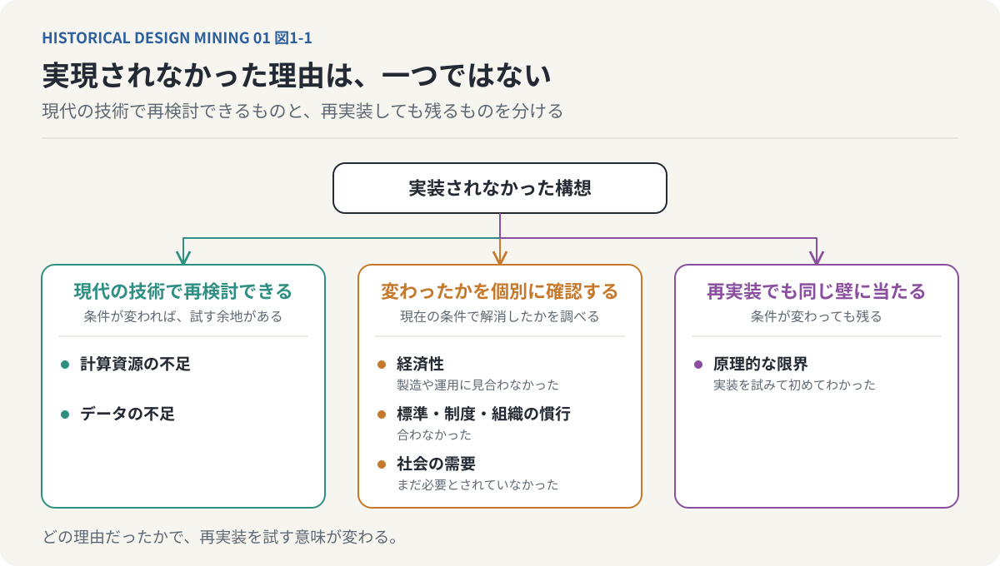
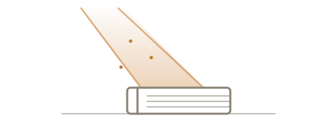
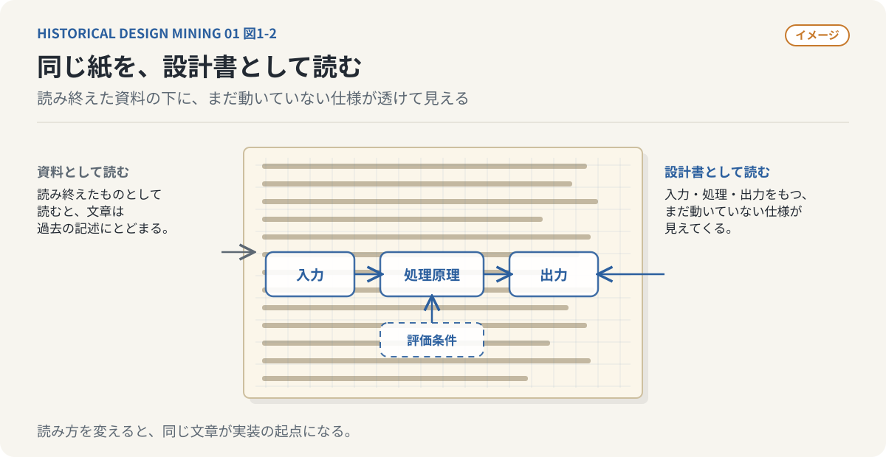
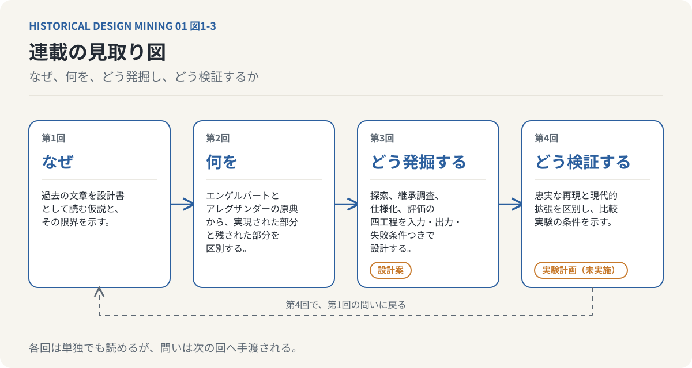

# 古い器に新しい水を入れる
## 第1回：過去の文章は、未来の設計書である

### 技術は進歩する。しかし、知識は必ずしも継承されない

私たちは、技術が時間とともに進歩していくものだと考えている。

新しい技術は古い技術を置き換え、優れた技術は生き残り、そうでない技術は淘汰されていく。現在使われている技術は、過去の膨大な試行錯誤の結果として選び抜かれたものだ。

おおむね、それは正しい。ただし、そこには一つの思い込みがある。

**現在の技術は、過去に生み出された優れた知識を、すべて継承しているのだろうか。**

技術の歴史を振り返ると、そうとは限らない。ある技術が普及するかどうかは、その技術が優れているかどうかだけでは決まらない。当時の計算機の性能、利用できるデータ、通信環境、製造コスト、産業構造、市場の需要。さまざまな条件によって、技術の運命は左右される。

優れた発想であっても、実装する手段が存在しなければ普及しない。実現されなかった理由は、計算資源の不足だけではない。製造や運用に見合う経済性がなかった。標準や制度、組織の慣行と合わなかった。社会がその機能をまだ必要としていなかった。あるいは、実装を試みて初めて、構想そのものに原理的な限界があるとわかった。

この区別は後で重要になる。理由が計算資源やデータの不足なら、現代の技術で再検討できるかもしれない。しかし原理的な限界が理由なら、再実装しても同じ壁に突き当たるだけである。

*図1-1：実現されなかった理由を、条件が変われば再検討できるもの、変わったかを個別に確認すべきもの、再実装しても残るものに分けて考える。*

つまり、技術の歴史とは、優れたアイデアが順番に実現されてきた歴史ではない。

**実現可能だったもの、実現する必要があったもの、そして実現する機会を得たものが、選択的に残されてきた歴史でもある。**

では、その選択から漏れた知識は、どこへ行ったのだろう。

---

### 実装されなかったことは、価値がなかったことを意味しない

過去の研究論文や技術書を読むと、奇妙な感覚を覚えることがある。数十年前に書かれた文章なのに、そこで論じられている問題が驚くほど現代的なのだ。

人間とコンピュータの協働。知的作業の支援。複雑なシステムの設計。知識の構造化。人間の意思決定を補助する仕組み。これらは現代の生成AIやAIエージェントをめぐる議論と深く重なっている。

もちろん、過去の研究がそのまま現在の技術を先取りしていた、と言いたいわけではない。

重要なのは、**問題設定や設計思想が、具体的な実装技術よりも長い寿命を持つことがある**という点だ。

ある研究者が1960年代に、人間の知的能力をコンピュータによって拡張する仕組みを構想したとする。当時の計算機では一部しか実現できず、実装できた機能だけが後世に継承され、構想全体は忘れられてしまったかもしれない。

しかし、現在の計算機や生成AIを使えば、当時は実現できなかった部分にも手が届く可能性がある。

そのとき私たちがしているのは、新しい技術の発明なのか。それとも、過去に発明されながら実現されなかったものを、ようやく実装することなのか。

両者は必ずしも区別できない。新しい技術によって、古い構想が初めて実行可能になることがあるからだ。

---

### 私たちは、過去の文献を読み終わったものとして扱っていないか

過去の研究を読む目的は、一般的には、その分野の歴史や先行研究を理解することにある。研究がどう成立し、どの問題が解決され、どの理論が否定されたのか。その経緯を知るために、古典的な論文や書籍を読む。

しかし、ここで読み方を変えてみたい。

**過去の文章の中に、まだ実装されていない設計書が含まれているのではないか、という視点で読む。**

例えば、古い研究論文に、ある情報処理システムの構想が書かれていたとする。そこには、解決しようとした問題、情報の表現方法、処理の原理、人間と計算機の役割分担などが記述されている。

当時は、それらを実現するだけの計算資源がなかったのかもしれない。結果として、その研究は構想の提示にとどまり、後続の研究でも十分に継承されなかった。

だが、その論文を、現在の技術で実装するための設計書として読んだらどうなるだろう。

問題設定を抽出する。システムの構成要素を特定する。入力と出力を定義する。当時の技術的制約を明らかにする。その制約を、現在の技術で置き換えられないか検討する。そして、実際にプログラムを作って動かしてみる。

ここでは、文献は単なる知識の参照先ではない。

**まだ動いていないソフトウェアの仕様が記された資料になる。**

*図1-2：（イメージ）同じ古い文章でも、資料として読むか、設計書として読むかで、見えるものが変わる。比喩であり、特定の文献を描いたものではない。*

研究を理解することが終点ではなくなる。理解した先に、実装という新しい行為が生まれる。

---

### 生成AIは、過去の知識へのアクセス可能性を変えた

これまで、古い専門的な文献を読み解くには、多大な労力が必要だった。数学的な背景を理解し、その分野特有の用語を調べ、同時代の研究を読み、著者が暗黙に前提としている知識を補わなければならない。

文献そのものを入手できても、内容を理解できるとは限らない。私は、この二つを区別したい。一つは、文献に物理的にアクセスできること。もう一つは、文献の内容に意味的にアクセスできることだ。

デジタルアーカイブや検索エンジンは、前者を大きく改善してきた。しかし、後者には依然として大きな隔たりがあった。

生成AIは、この隔たりを縮める。難解な概念を説明し、数式の意味を整理し、異なる研究分野との関係を示し、文章に含まれる暗黙の前提を検討できる。

もちろん、生成AIによる解釈が正しいとは限らない。原典との照合は欠かせない。それでも、専門的な文献を理解するために必要な準備のコストは、大きく変わり始めている。

そして、変化は読解だけにとどまらない。生成AIは、文章に書かれた構想を、プログラムの設計へと変換することも支援できる。自然言語で書かれた処理の説明からアルゴリズムを抽出し、曖昧な記述を洗い出し、検証可能な仕様へと分解する。仕様をもとにコードを生成し、テストを実行する。

つまり、**かつては理解することすら難しかった文章を、理解するだけでなく、動作させるところまで持っていける**ようになりつつある。

---

### 古い研究を、そのまま実装すればよいわけではない

過去の研究を再実装しても、新しい価値を生むとは限らない。既に別の名前で実現されている、過去に十分検証されて有効ではないと判断された、当時の制約が解消されても原理的な問題が残っている、といった場合がある。

また、過去の論文に書かれた曖昧な構想を、生成AIが都合よく補完しただけのものを、原典の再実装と呼ぶこともできない。

だからこそ、必要なのは単純な復元ではなく、調査と検証である。

確かめるべきことは五つある。

1. その構想は、現在の技術にどの程度継承されているか。
2. 継承されなかった部分は何か。
3. それが実装されなかった理由は何か。
4. その理由は、現在の技術で解消されているか。
5. 実際に実装したとき、既存の技術と比べて価値があるか。

**求められるのは、過去の構想を、現代の技術と評価基準によって、もう一度実験の対象に戻すことである。**

---

### 古い器に、新しい水を入れる

この連載では、過去の研究や文章の中から、現在の技術に十分継承されていない構想を発掘し、現代の技術によって再実装する方法を考えていきたい。

最初に取り上げるのは、人間の知性を拡張するコンピュータの構想と、複雑な設計問題を構造化するための理論である。いずれも数十年前に提案されたものだが、生成AIやAIエージェントの登場によって、新しい実装の可能性を検討できる。

古い文献を探索し、継承関係を調べ、設計仕様に変換し、コードを生成して動作を検証する。この流れを一連の仕組みにできれば、過去の文献を継続的に発掘し、実行可能なソフトウェアへ変換できる。

*図1-3：連載の見取り図。第3回は設計案、第4回は実験計画であり、実施した結果ではない。*

未来の技術を探す場所は、必ずしも最新の論文や新興企業の中だけではない。何十年も前に出版された書籍や、忘れられた研究報告書の中にも存在する。

**古い器に、新しい水を入れる。**

過去の知識を保存するのではない。過去の知識を、もう一度動かしてみる。そんな研究の仕方を考えてみたい。

ただし、この連載が示すのは研究の進め方の提案である。実際に再実装し、既存の技術と比較した記録ではない。第4回で述べる比較実験も、実施した結果ではなく、実施する場合の計画として読んでほしい。

---

*次回：第2回「歴史の中に埋もれた設計を発掘する」*
