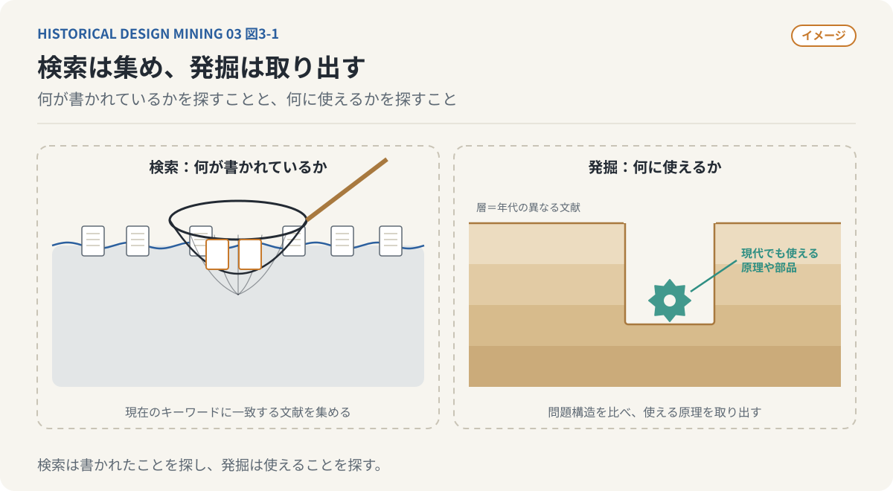
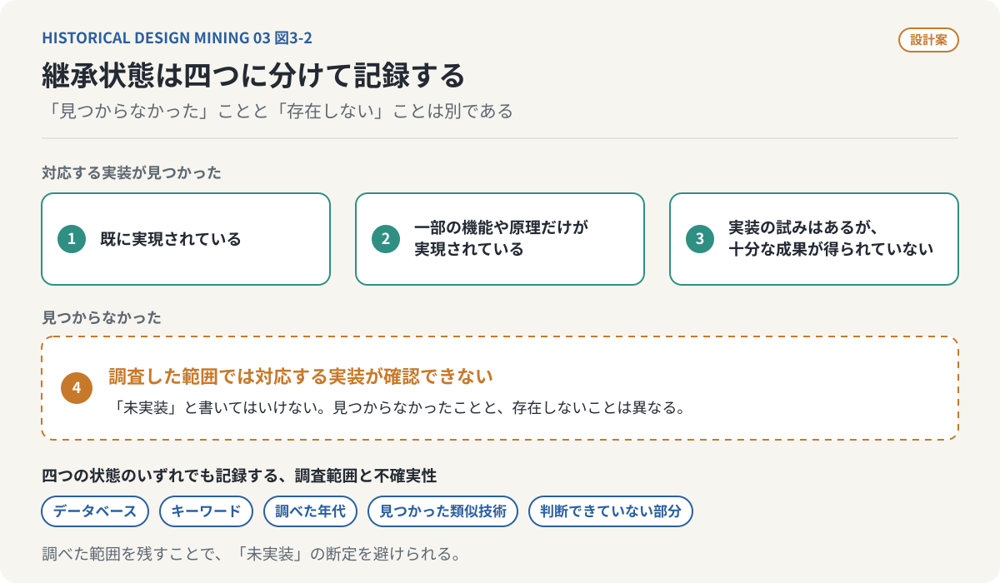
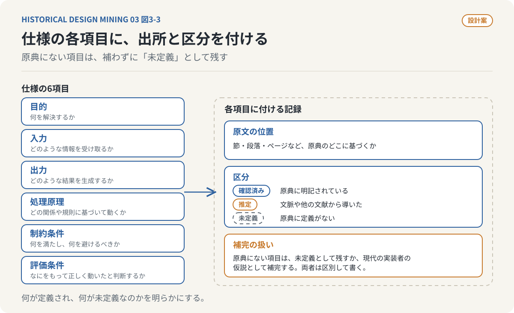
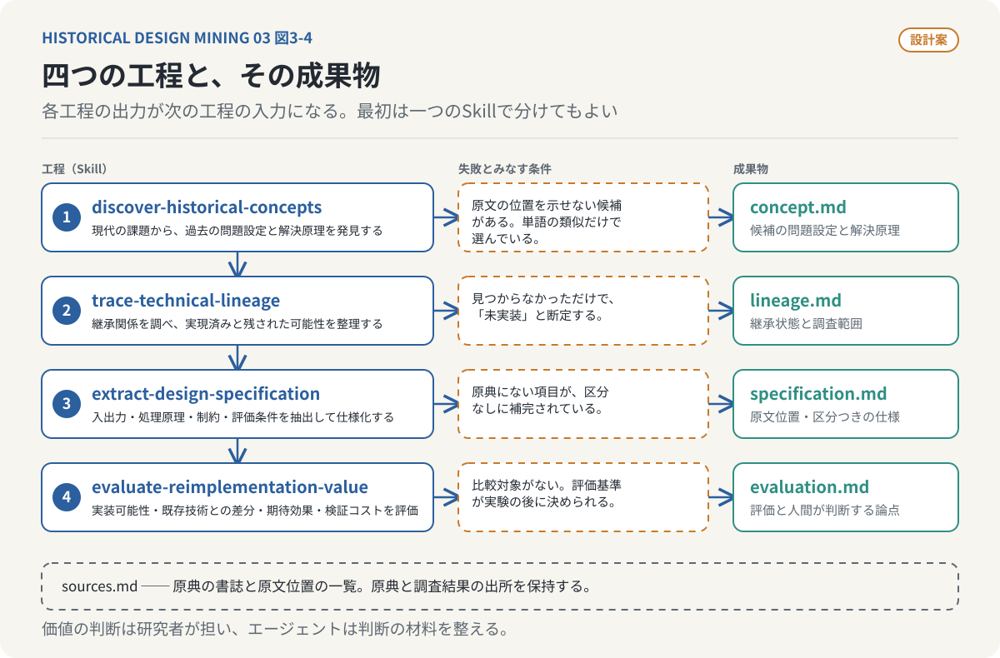
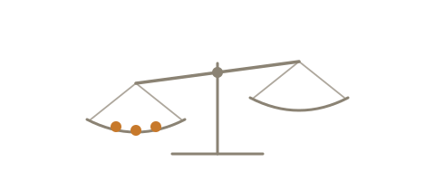

# 古い器に新しい水を入れる
## 第3回：文献を読むAIから、設計を発掘するAIへ

### 過去の知識を発掘するという作業を、仕組みにできないだろうか

前回、ダグラス・エンゲルバートとクリストファー・アレグザンダーの研究を取り上げた。どちらも数十年前の研究だが、現代の生成AIやソフトウェア開発に接続できる問題を提示している。

ここで、一つの疑問が生まれる。こうした研究を見つける作業は、偶然に頼るしかないのだろうか。

古い論文を読み、内容に興味を持ち、現代の技術との共通点に気づく。そこから関連研究を調べ、実装可能性を検討する。しかし、世界の膨大な論文や技術報告書のすべてを人間が読み、現代の技術との関係を調べることはできない。

**過去の知識を発掘するという研究活動そのものを、AIエージェントによって実行できないだろうか。**

---

### 検索することと、発掘することは違う

一般的な文献検索では、現在の研究テーマに関連するキーワードで論文を探し、引用関係を辿って研究分野の現状を整理する。しかし、今回探すのは必ずしも現代の研究分野に直接属する文献ではない。

1960年代の建築設計の理論が、現代のソフトウェアアーキテクチャに利用できるかもしれない。古い認知心理学の研究が、AIエージェントの記憶管理に応用できるかもしれない。

当時の研究者は現代の技術用語を使っていない。そこで必要になるのは単語の一致ではなく、問題構造の比較である。

過去の研究が解決しようとした問題は何か。現代のどの課題と共通するか。提案された解決原理は現代の技術で実装できるか。

**文献検索が「何が書かれているか」を探す行為だとすれば、発掘は「何に使えるか」を探す行為である。**



*図3-1：（イメージ）検索は「何が書かれているか」を探し、発掘は「何に使えるか」を探す。網で集めるか、掘って取り出すかという比喩であり、特定の検索手法を描いたものではない。*

---

### 最初の仕事は、過去の文章から問題設定を取り出すことである

いきなりアルゴリズムを探すのは適切ではない。特定のアルゴリズムは当時の計算資源やデータの制約に合わせて設計されている場合があるからだ。

例えば、大量の情報から知識を発見する仕組みで、当時は記憶容量が限られたため複雑な索引構造を使っていたとする。現代であれば別のデータ構造や機械学習を利用できるかもしれない。

そこでAIエージェントには、研究が対象とする問題、その原因、提案された解決原理、具体的な実現方法、当時の技術的制約を区別して抽出させる。

原典に明示された内容と、AIが推定した内容は混同しない。抽出した項目には原文の位置（節、段落、ページなど）を付け、**確認済み**（原典に明記されている）、**推定**（文脈や他の文献から導いた）、**未定義**（原典に定義がない）のいずれかを必ず記録する。事実、文献間比較から導いた解釈、現代的な提案も区別する。

**AIエージェントが生成した説明よりも、その説明が原典のどこに基づくかを追跡できることの方が重要である。**

---

### 次に、その構想が現在どこまで実現されているかを調べる

抽出した構想が別の名前で実現されている可能性は常にある。例えば、複数の作業を分割して自律的に処理する構想は、ワークフローエンジン、分散処理、AIエージェントなどと問題設定を共有し得る。

調査では四つの状態を区別したい。

1. 既に実現されている。
2. 一部の機能や原理だけが実現されている。
3. 実装の試みはあるが、十分な成果が得られていない。
4. 調査した範囲では対応する実装が確認できない。

四番目を安易に「未実装」と呼んではいけない。見つからなかったことと、存在しないことは異なる。

どのデータベースを、どのキーワードで、どの年代まで調べたか。どの類似技術が見つかり、どの部分を判断できていないか。調査範囲と不確実性も記録する。



*図3-2：継承状態の四区分。見つかったものは三つの状態に分け、見つからなかったものは「調査した範囲では確認できない」と書く。どの状態でも、調べたデータベース、キーワード、年代、判断できていない部分を記録する。*

---

### 文献を、実行可能な設計仕様へ変換する

過去の論文は現代のソフトウェア設計書として書かれていない。目的は明確でも、入力、出力、処理順序、異常系や評価条件が曖昧なことはある。

そのままコード生成AIに渡しても実装はできるかもしれない。しかし、AIが不足した仕様を補完してしまえば、原典とは異なるシステムになる。

そこで、原典の分析とコード生成の間に仕様化を置く。

- **目的**：何を解決するか。
- **入力**：どのような情報を受け取るか。
- **出力**：どのような結果を生成するか。
- **処理原理**：どの関係や規則に基づいて動くか。
- **制約条件**：何を満たし、何を避けるべきか。
- **評価条件**：何をもって正しく動いたと判断するか。

原典にない項目は未定義として残すか、現代の実装者の仮説として補完する。ただし、両者は区別する。各項目には、先に述べた原文の位置と、確認済み・推定・未定義の区分を付ける。

**過去の文章を設計書として読むとは、曖昧な文章を無理に確定させることではない。何が定義され、何が未定義なのかを明らかにすることである。**



*図3-3：仕様の各項目には、原文の位置と、確認済み・推定・未定義の区分を付ける。原典にない項目は補わずに未定義として残すか、現代の実装者の仮説として補完し、両者を区別する。*

---

### AIエージェントの役割を、四つに分けてみる

探索、調査、解釈、仕様化は評価方法が異なるため、役割を分ける。

- `discover-historical-concepts`：現代の技術課題から関連する過去の問題設定や解決原理を発見する。
- `trace-technical-lineage`：研究や製品への継承関係を調べ、実現済みの部分と残された可能性を整理する。
- `extract-design-specification`：原典から入出力、処理原理、制約、評価条件を抽出して仕様化する。
- `evaluate-reimplementation-value`：実装可能性、既存技術との差分、期待効果、検証コストを評価する。

四つの工程は、入力、出力、失敗とみなす条件で区別できる。



*図3-4：四つの工程と成果物。各工程の出力は次の工程の入力になる。これは設計案であり、実装や動作確認はしていない。価値の判断は研究者が担い、エージェントは判断の材料を整える。*

| 工程 | 入力 | 出力 | 失敗とみなす条件 |
|---|---|---|---|
| `discover-historical-concepts` | 現代の技術課題、対象とする文献群 | 候補となる問題設定と解決原理（原文位置つき）、探索範囲の記録 | 原文の位置を示せない候補がある。単語の類似だけで選んでいる。探索したデータベース、キーワード、年代が記録されていない |
| `trace-technical-lineage` | 候補の概念、出典一覧 | 継承状態の区分（四つの状態）、調査範囲と不確実性 | 見つからなかっただけで「未実装」と断定している。類似技術を見つけながら比較していない |
| `extract-design-specification` | 原典、候補の概念、継承調査の結果 | 目的、入力、出力、処理原理、制約条件、評価条件。各項目に原文位置と確認済み・推定・未定義の区分 | 原典にない項目が区分なしに補完されている。原文位置のない項目がある |
| `evaluate-reimplementation-value` | 仕様、継承調査の結果 | 実装可能性、既存技術との差分、期待効果、検証コスト、人間が判断すべき論点 | 比較対象がない。価値を断定している。評価基準が実験の後に決められている |

最初から四つの独立したAIエージェントとして動かす必要はない。一つのAgent Skillの中で責務を区別してもよい。重要なのは、工程ごとの誤りを発見し改善できるようにすることだ。

---

### 実装するなら、Agent Skillをどう構成するか

Agent Skillの構成は、できるだけ単純にしたい。以下は実装を想定した設計案であり、まだ動作を確かめたものではない。

```text
historical-design-mining/
├── SKILL.md
├── references/
│   ├── discovery.md
│   ├── lineage.md
│   ├── specification.md
│   └── evaluation.md
└── templates/
    ├── research-report.md
    └── design-spec.md
```

`SKILL.md`には、Agent Skillの仕様が必須とする `name` と `description` のメタデータに続けて、目的と全体手順を書く。`references/` には工程別の方法、`templates/` には出力形式を置く。なお、公開されているAgent Skillの仕様（[agentskills.io](#参考文献)）がテンプレートなどの置き場として挙げるのは `assets/` である。ここでは役割がわかりやすいように `templates/` と呼ぶが、使う環境によっては `assets/` に読み替える。

調査の成果物は次のように管理する。`sources.md` は原典の書誌と原文位置の一覧、残りの四つは四つの工程の出力に対応する。

```text
research/
├── sources.md          # 原典の書誌、原文位置
├── concept.md          # discover-historical-concepts の出力
├── lineage.md          # trace-technical-lineage の出力
├── specification.md    # extract-design-specification の出力
└── evaluation.md       # evaluate-reimplementation-value の出力
```

原典と調査結果の出所を保持することで、人間によるレビュー、後日の再調査、別の文献への手順の再利用が可能になる。

---

### 実際に、アレグザンダーの研究を入力してみる

『Notes on the Synthesis of Form』を入力したとする。まず、複雑な設計課題における要求や制約の相互作用と、問題構造に基づく分割という原理を抽出する。

次に設計パターン、モジュール分割、グラフ分割、要求工学などの関連分野と、初期の方法の再現を試みた先行研究（第2回で取り上げた[Gabriel, 2023](02-excavating-forgotten-designs.md#参考文献)など）を調べる。

現代的な拡張として、自然言語の要求仕様から生成AIが依存関係を抽出し、グラフを作成して分割候補を求める仕組みを考えられる。

入力は要求仕様書、出力は要求間の関係グラフと分割候補。処理は要求抽出、関係分類、グラフ構築、候補生成。評価は関係抽出の正確性や、生成された設計の結合度などで行う。

ただし、生成AIによる要求抽出やソフトウェア設計への適用は原典に忠実な再現ではなく、現代の技術による拡張である。その違いを明示する必要がある。

---

### それでも、AIに研究の価値を決めさせてはいけない

AIが構想を有用だと判断することと、その構想に実際の価値があることは同じではない。類似性は有用性の証明にはならないし、生成された仕様が原典に適合する保証もない。



発掘対象の価値、保持すべき原理、現代の実装で許容する変更、何をもって研究成果と呼ぶか。こうした目的と価値の判断は研究者が担う。

一方、文献探索、引用調査、記述比較、仕様の構造化などはエージェントで支援できる。

**AIエージェントに任せたいのは、研究の価値判断そのものではなく、価値判断に必要な材料を集め、検証可能な形に整理することである。**

---

### 文献を読むことから、文献を動かすことへ

文献を探索し、設計原理を抽出し、継承関係を調べ、残された可能性を見つけ、仕様化する。この工程が成立すれば、文献は単なる参照資料ではなく、実装の起点となる。

しかし、仕様書ができただけでは価値は証明されない。実際にソフトウェアを作り、既存技術と比較する必要がある。期待した成果が出ても、出なくても、条件と結果が記録されていれば研究として学びが残る。

**過去の知識を再実装することは、新しい技術を発明することになり得るのだろうか。**

---

### 参考文献

- Agent Skills. *Specification*. https://agentskills.io/specification （SKILL.mdの形式とディレクトリ構成）
- Richard P. Gabriel (2023). *Notes on “Notes on the Synthesis of Form”*. 書誌は第2回の参考文献を参照。

---

*次回：第4回「古い器に、新しい水を入れる」*
