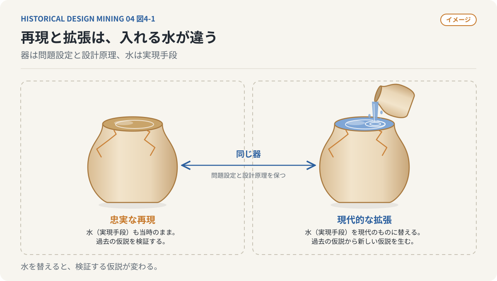
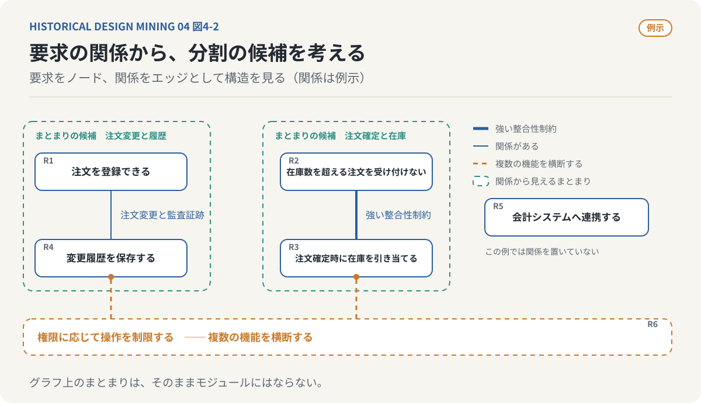
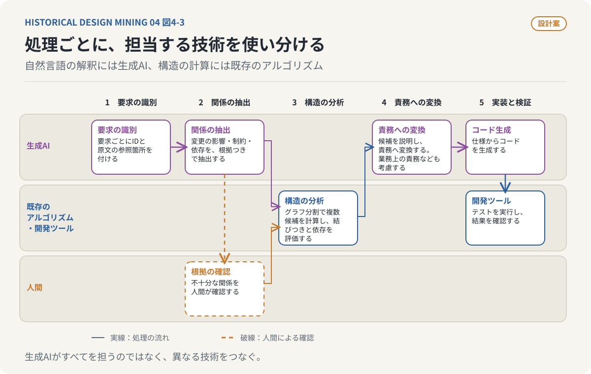
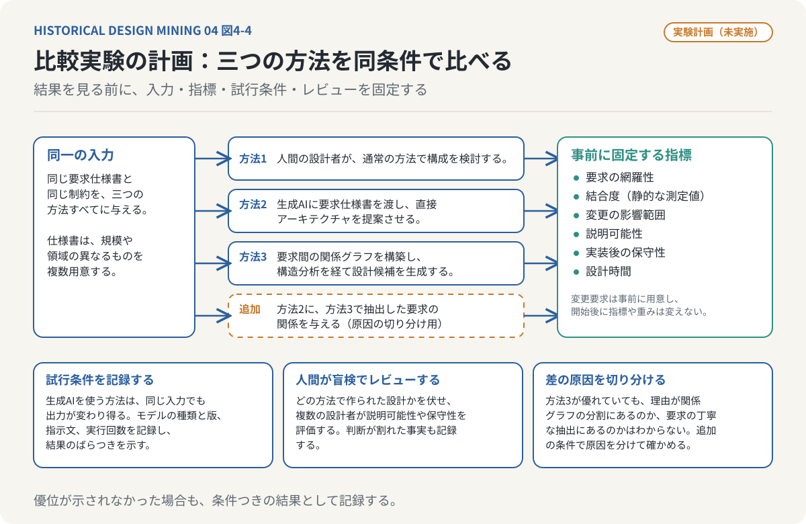

# 古い器に新しい水を入れる
## 第4回：古い器に、新しい水を入れる

### 過去の知識を、もう一度動かしてみる

これまでの3回で、過去の研究を現代の技術によって再実装するという構想について考えてきた。

第1回では、技術の進歩が過去の知識をすべて継承しているわけではないことを指摘した。第2回では、エンゲルバートとアレグザンダーの研究を取り上げ、残された可能性を検討した。第3回では、そうした構想を発掘し、設計仕様へ変換するAIエージェントを考えた。

しかし、ここまでの作業では、まだ何も実証していない。古い研究を見つけ、現在の技術との共通点を見いだし、実装できそうな仕様の作り方を考えた。それだけでは新しい価値があることの証明にはならない。

**実際にソフトウェアとして動かし、現在の技術と比較することである。**

ただし、この回で述べる再実装と比較実験は、実施した記録ではない。実施する場合の構想と実験計画であり、結果はまだ存在しない。

---

### 再実装には、二つの異なる目的がある

過去の研究をソフトウェアとして実現する場合、二つの方法がある。原典に忠実な再現と、現代の技術による拡張である。

前者では当時提示されたアルゴリズムや処理原理をできる限り変更せず、論文に記載された条件で動かす。何が実際に動作するかを確かめることが目的である。

後者では原典が解決しようとした問題や設計原理を保持しながら、実現手段を変更する。当時は人間が手作業で分類していた情報を生成AIで抽出したり、計算量の制約で単純化された処理を現代の計算機で実行したりする。

この二つを混同してはいけない。

**原典の再現は過去の仮説を検証する。現代的な拡張は、過去の仮説から新しい仮説を生み出す。**



*図4-1：（イメージ）器は問題設定と設計原理、水は実現手段を表す。忠実な再現は器も水も当時のままで過去の仮説を検証し、現代的な拡張は器を保ったまま水を替えて新しい仮説を生む。*

---

### アレグザンダーの設計理論を、ソフトウェアとして動かしてみる

アレグザンダーの『Notes on the Synthesis of Form』が論じた、要求や制約の相互関係による設計問題の構造化を、現代の業務システムに適用するとしたら、どうなるかを考えてみる。

要求仕様書には、利用者の操作、データの整合性、性能、監査証跡、外部システムとの連携などが記述されている。通常、設計者はこれらを画面や機能に分け、システム構成を考える。

この構想では、まず個々の要求を抽出し、要求同士の依存や競合を明らかにする。関係をグラフとして表現し、その構造から設計の分割候補を得る。

例えば「注文を登録できる」「在庫数を超える注文を受け付けない」「注文確定時に在庫を引き当てる」「変更履歴を保存する」「会計システムへ連携する」「権限に応じて操作を制限する」という要求を考える。

注文確定と在庫引当には強い整合性制約がある。注文変更と監査証跡にも関係がある。権限管理は複数機能を横断する。こうした関係を分析すると、単純な画面単位とは異なる構造が見えるかもしれない。



*図4-2：要求の関係の例。関係は本文の記述に基づく例示であり、生成AIが抽出した結果ではない。グラフ上のまとまりは分割の候補であり、そのままモジュールになるとは限らない。*

これは原典のアルゴリズムの忠実な再現ではない。しかし、原典の問題設定を現代へ持ち込むことで、検証可能なシステムを構想できる。

---

### AIエージェントに、どこまで任せられるのか

まず、自然言語の要求仕様書を生成AIで解析し、個々の要求を識別する。要求にはIDと原文の参照箇所を付与する。

次に、要求間の関係を抽出する。変更による影響、同時に満たすべき制約、成立の前提となる依存関係などである。ただし抽出の正しさは保証されないため、関係の根拠を残し、不十分なものは人間が確認する。

次のグラフ分割や構造分析には、既存のアルゴリズムを利用できる。複数の候補を計算し、内部の結びつきと外部への依存の程度を評価する。

その後、AIエージェントが構成候補を説明し、ソフトウェアの責務へ変換する。ただしグラフ上のまとまりは、そのままモジュールになるとは限らない。業務上の責務、トランザクション境界、技術的制約も必要だからだ。

自然言語の解釈には生成AIを使う。構造的な計算には既存のアルゴリズムを使う。実装やテストではコード生成と開発ツールを組み合わせる。



*図4-3：処理ごとの担当の想定。自然言語の解釈には生成AI、構造の計算には既存のアルゴリズムを使い、不十分な関係は人間が確認する。設計案であり、実際に動かした結果ではない。*

**AIエージェントの役割は、すべての処理を生成AIで置き換えることではない。異なる技術を接続し、研究の仮説を実行可能なシステムに変換することである。**

---

### 動いたことと、有用であることは違う

要求仕様書から関係グラフが生成され、ソフトウェアの分割候補が出たとする。しかし、その候補は本当に優れているのだろうか。人間の設計より変更に強いのか。既存の設計支援方法に比べて何が改善されるのか。

例えば、三つの方法を比較する実験が考えられる。

1. 人間の設計者が通常の方法で構成を検討する。
2. 生成AIに要求仕様書を渡し、直接アーキテクチャを提案させる。
3. 要求間の関係グラフを構築し、構造分析を経て設計候補を生成する。

同じ仕様書を与え、要求網羅性、結合度、変更の影響範囲、説明可能性、実装後の保守性、設計時間を比較する。

単一の指標で設計の優劣は決められない。実験の条件は、結果を見る前に決めておく必要がある。

- **同一の入力**：三つの方法に、同じ要求仕様書と同じ制約を与える。仕様書は規模や領域の異なるものを複数用意する。
- **事前に固定する指標**：結合度は静的な測定値、変更の影響範囲はあらかじめ用意した変更要求を適用したときに修正が及ぶ範囲、というように測り方を先に決める。実験を始めてから指標や重みを変えない。
- **試行条件**：生成AIを使う方法は、同じ入力でも出力が変わり得る。モデルの種類と版、指示文、実行回数を記録し、複数回の結果のばらつきを示す。人間の設計者は、経験年数など条件を記録する。
- **人間によるレビュー**：どの方法で作られた設計かを伏せたうえで、複数の設計者が説明可能性や保守性を評価する。評価者間で判断が割れた場合は、その事実も記録する。
- **差の原因の切り分け**：第3の方法が優れていた場合も、その理由が関係グラフ分割にあるのか、要求を丁寧に抽出したことにあるのかはわからない。第2の方法に、第3の方法で抽出した要求の関係を与える条件を加えるなどして、原因を分けて確かめる。



*図4-4：比較実験の計画。条件と指標は結果を見る前に固定する。この実験は実施しておらず、結果は存在しない。*

こうした実験を重ねて初めて、過去の原理が現代に価値を持つかを判断する材料が得られる。優位が示されなかった場合も、それは失敗ではなく、条件つきの結果として記録する。

---

### AIエージェントによる実装を、再現可能な研究にする

研究開発の工程は、次のようになる。

```text
Historical Research
       |
       v
Concept Discovery
       |
       v
Technical Lineage Analysis
       |
       v
Design Specification
       |
       v
AI-Assisted Implementation
       |
       v
Experimental Validation
       |
       v
Research Findings
```

文献探索なら検索条件。継承調査なら研究や技術との関係。仕様化なら原典との対応。実装ならコードとテスト。検証なら条件、データ、指標と結果を残す。

期待した結果が得られなかったときにも、原典の構想、解釈、仕様、実装、評価方法のどこに問題があるかを切り分けられるようにする。

**過去の知識を発掘し、実装し、検証する研究開発プロセスそのものを、再利用可能な仕組みにすることである。**

---

### 重要なのは、失敗した研究も再び実験の対象になることである

発掘した構想を再実装しても、期待した成果が得られないことはある。原典に問題があったかもしれないし、現在の技術が別の方法で解決しているため意義が小さいこともある。

それでも再実装には意味がある。過去の研究がうまくいかなかった理由を現代の条件で検証できるからだ。

計算資源の不足が理由だったなら現代の計算機で確かめられる。データ不足が理由だったなら現在のデータで試せる。性能問題が解消しても価値がなければ、別の限界が明らかになる。

**過去に提示された仮説を、現代の条件によって検証可能な状態に戻すことにある。**

成功と失敗のいずれも、条件と結果を記録すれば次の研究へ継承できる。

---

### 過去の文献を、実行可能な研究資産へ変える

AIエージェントが文献から設計原理を抽出し、実装仕様を作れるようになれば、論文は単なる知識の参照先ではなく、実装可能な仮説を含んだ研究資産になる。

一つの論文から複数の候補が得られるかもしれない。実現済みのもの、今も困難なもの、現在の生成AIと計算資源で実装可能になったもの。それらを分けて管理し、新しい技術が登場したら再評価する。

過去の研究の価値は、発表された時点で確定するものではない。技術的制約が変われば、同じ研究から引き出せる価値も変わる。

既存の文献検索や一般的なコード生成とは目的の異なる、過去の知識と現在の技術を継続的に照合して研究機会を発見する仕組みを構想できる。類似の取り組みがすでにあるかどうかは、第3回で述べた継承調査の対象として確認する必要がある。

---

### 技術の発明とは、何を意味するのだろうか

1960年代の設計原理を生成AIとグラフ解析で実装したとする。原理は新しくないが、実現手段や機能は当時存在しなかったものかもしれない。

古いアイデアの再現なら歴史的な再現実験である。古い方法の実用化なら技術的実装成果である。その組み合わせから従来と異なる価値が生まれれば、新しい技術的貢献になり得る。ただし、そう呼べるのは、先行研究を調べて何が既知で何が新しいのかを示し、比較実験で差を確かめられた場合に限られる。

ここで重要なのは、アイデアがいつ生まれたかではない。

**そのアイデアによって、これまで実現できなかった何が可能になったのか。**

---

### 古い器に、新しい水を入れる

技術の歴史には、実装されなかった構想、部分的にしか継承されなかった原理、検証されなかった仮説が残されている。

生成AIは、難解な文献を読み、異分野の概念を結び、継承を調べ、自然言語の原理を仕様に変換することを支援できる。ただし、その解釈は原典で確かめなければならない。そうして作った仕様をAIエージェントによって実装し、検証する。

古い文章がすべて優れた設計書になるわけではない。再実装しても価値が生まれないかもしれない。しかし、それは試さなければわからない。そして試すためのコストは、生成AIの登場によって変化している。

第1回の問いに戻ろう。現在の技術は、過去に生み出された優れた知識をすべて継承しているのだろうか。継承されていない構想が残っている可能性は高そうだ。しかし、継承されなかった構想に価値があるかどうかは、継承調査と実験の結果によって初めてわかる。この連載が示したのは、その確かめ方の構想であって、確かめた結果ではない。

未来の技術を生むために、未来だけを見る必要はない。過去の研究には、まだ実現していない未来が残されているかもしれない。

**過去の文献を、未来のソフトウェアのソースコードとして読む。**

古い器に、新しい水を入れる。それは、過去の知識を使って、新しい技術の可能性を探すということなのだと思う。

---

*連載「古い器に新しい水を入れる」完。*
